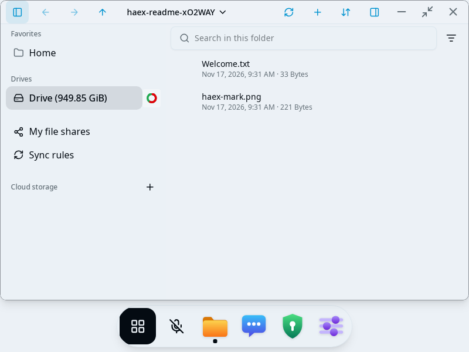
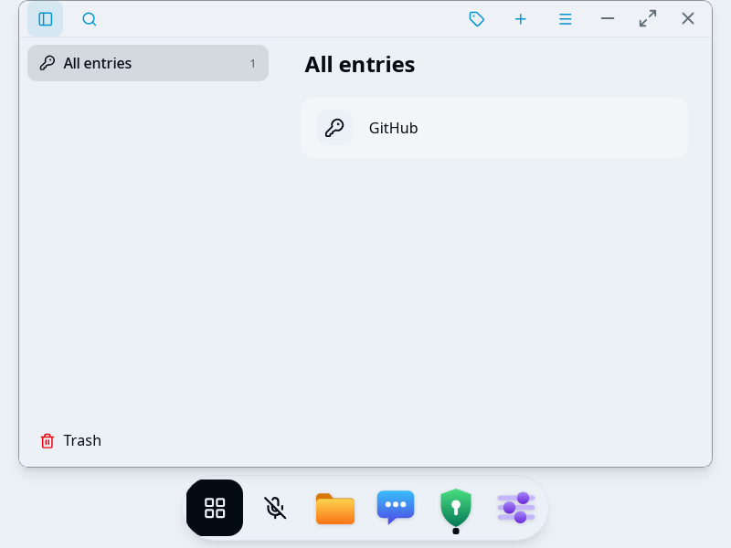
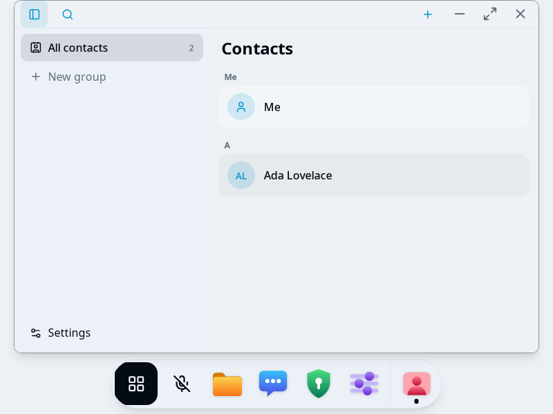
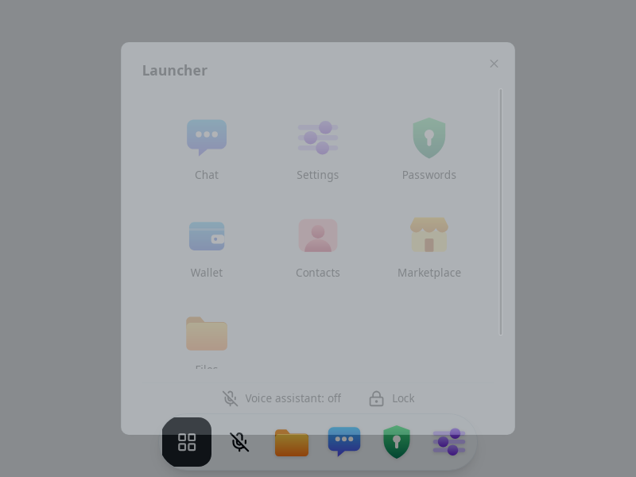
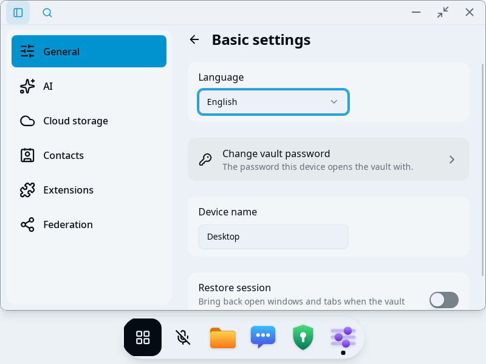

<p align="center"></p>

<h1 align="center">HaexVault</h1>

<p align="center"><strong>Sync files and app data across your devices.</strong></p>

<p align="center">HaexVault syncs files and data directly between your devices. No central sync server is required: devices on the same local network can sync without an internet connection.</p>

<p align="center"><a href="https://github.com/haex-space/haex-vault/releases/latest">Download HaexVault</a> · <a href="#how-sync-works">How sync works</a> · <a href="#build-from-source">Build from source</a></p>

## Keep your devices and data together

Your vault stays usable on each device, even when the network is down. Linked
devices exchange changes when they can reach each other: directly over the
local network at home, or over the internet when you are away.

Devices exchange vault changes over an authenticated, encrypted QUIC
connection. No server is required to store or sync your vault. Depending on
the network, relay services can help devices find or reach one another; on
the same LAN, they can sync without internet access.

## What this lets you do

- **Browse your phone from your desktop.** Open files on another reachable device from HaexVault.
- **Back up phone data to a device you control.** Set up file sync from your Android phone to your desktop or an encrypted folder you choose. Android contacts can also sync with the vault and appear on your other devices.
- **Keep using your vault offline.** Read and change local data without a network connection. Changes sync when your devices can connect again.
- **Use one vault across your devices.** Passwords, contacts and other vault data follow the vault's sync rules; files can be browsed or copied through configured file sync.

## See HaexVault

Screenshots show HaexVault on desktop with sample data in a fresh demo vault.

<p align="center">
  
  
</p>
<p align="center"><sub>Browse files on a device · Keep credentials organized in your vault</sub></p>

<p align="center">
  
  
</p>
<p align="center"><sub>Keep contacts in the vault · Open the tools and apps in your vault</sub></p>

<p align="center">
  
</p>
<p align="center"><sub>Set up HaexVault and choose how each device behaves</sub></p>

## How sync works

Each device keeps its own encrypted copy of the vault. When two linked devices
can reach one another, they exchange changes over an authenticated QUIC
connection. The sync does not depend on a server holding the vault or carrying
its data.

- **At home:** devices on the same local network can sync directly, even when
  the internet is unavailable.
- **Away from home:** a desktop can browse or receive backups from a phone when
  both devices are reachable over the internet. Network configuration and
  firewalls can affect reachability.
- **While disconnected:** each device remains usable with its local data and
  syncs changes after connectivity returns.

On Android, sync runs while HaexVault is in the foreground. When you open the
app again, it catches up on changes made elsewhere.

## Extend HaexVault with web apps

Build an app with Vue, React, Angular, Svelte or another SPA framework. Apps
can store structured data in SQLite; HaexVault's CRDT-based sync replicates
changes and resolves concurrent edits across devices, so developers do not
have to implement sync themselves.
With the required permissions, apps can use files, internet access, contacts,
AI agents and other HaexVault capabilities. Users grant those permissions.

## AI assistant

HaexVault includes an assistant that can use tools you allow. Run a supported
model locally, or configure an AI provider. Local inference can work without
sending prompts to an external model service; provider-backed models require
that provider to be reachable.

## Get started

Download an installer or APK from the [latest GitHub release](https://github.com/haex-space/haex-vault/releases/latest). HaexVault currently targets Linux, macOS, Windows and Android. On first launch, create a vault or link this device to one you already use.

The project is under active development. Installer availability and feature coverage can change between releases; check the release notes for the current build.

## Build from source

HaexVault is a Tauri 2 app with a Nuxt frontend and a Rust backend. The build
instructions, platform prerequisites, Android setup and release process are
in the [developer and maintainer guide](#building-haexvault).

## Project documentation

- [Development guide](#building-haexvault) — build, test and release HaexVault.
- [Specifications](specs/) — detailed product behavior and technical contracts.
- [License](#license) — AGPL-3.0-or-later.

<details>
<summary>Developer and maintainer guide</summary>

## Building HaexVault

HaexVault is a Tauri 2 app with a Nuxt frontend and a Rust backend. CI builds
and tests it on Ubuntu 24.04 (`.github/workflows/ci.yml`). The other systems
below follow the upstream requirements of Tauri and HaexVault's native
dependencies but are not built in CI.

### Requirements on every system

- **Rust** 1.95 or newer through [rustup](https://rustup.rs) (`rust-version`
  in `src-tauri/Cargo.toml`; CI uses the current stable).
- **Node.js** `^22.19.0`, `^24.11.0` or `>=26` and **pnpm** 9.15 through
  Corepack: `corepack enable`.
- Native build tools for these crates, all compiled from source during the
  Rust build:
  - SQLCipher with a vendored OpenSSL (`rusqlite` from `haex-crdt`) needs a C
    compiler, **Perl**, **make** and **libclang** (its bindings are generated
    with bindgen).
  - `aws-lc-sys` (rustls) needs a C/C++ compiler.
  - llama.cpp, the local inference engine (`llama-cpp-sys-2`), needs **CMake**
    and a C++ compiler.

### Linux

**Debian / Ubuntu** (what CI installs):

```bash
sudo apt install libwebkit2gtk-4.1-dev build-essential cmake curl wget file \
  libxdo-dev libssl-dev libayatana-appindicator3-dev librsvg2-dev \
  libasound2-dev libclang-dev
```

**Arch**:

```bash
sudo pacman -S --needed webkit2gtk-4.1 base-devel cmake curl wget file openssl \
  appmenu-gtk-module libappindicator-gtk3 librsvg xdotool alsa-lib clang perl
```

**Fedora**:

```bash
sudo dnf install webkit2gtk4.1-devel openssl-devel cmake curl wget file \
  libappindicator-gtk3-devel librsvg2-devel libxdo-devel alsa-lib-devel \
  clang-devel perl-FindBin perl-IPC-Cmd
sudo dnf group install "c-development"
```

`libasound`/`alsa-lib` is for microphone input (the default `voice` feature).

The repository's Nix devShell supplies the compiler, Java, Android SDK/NDK,
and CUDA build environment. On x86-64 Linux it uses the host's WebKitGTK
and GPU driver libraries through `scripts/with-nix-host-bridge.sh`. The bridge
discovers standard and Debian/Ubuntu multiarch library directories and selects
a matching libc and loader. Install the host development packages above first.

```bash
nix develop --command pnpm install --frozen-lockfile
nix develop --command pnpm tauri:dev:cuda
```

Alternatively, enter `nix develop` once and run `pnpm tauri:dev:cuda` inside
it. `direnv` with the repository's `.envrc` provides the same project environment.
For a CPU build use `pnpm tauri:dev` inside that environment.

Global Android compiler exports (`CC`, `CXX`, `AR`, and related tools) and
personal CUDA library-path workarounds are unnecessary. Remove them from the
shell startup configuration. Existing terminals retain old values; clear those
values before entering the project shell, or start a fresh login session.
The project's Android commands also obtain their SDK/NDK and Java from the
devShell. Building with a separately installed host toolchain remains supported
outside the devShell.

When switching an existing build directory from the host toolchain to Nix,
clear llama.cpp's cached compiler paths once:

```bash
nix develop --command scripts/with-nix-host-bridge.sh cargo clean \
  --manifest-path src-tauri/Cargo.toml -p llama-cpp-sys-2
```

### macOS

- Xcode, or the Xcode Command Line Tools: `xcode-select --install`. They
  bring the C compiler, make and Perl.
- CMake: `brew install cmake`.
- The app runs on macOS 10.15 or newer (`minimumSystemVersion` in
  `src-tauri/tauri.conf.json`): llama.cpp uses `std::filesystem`.
- If bindgen cannot find libclang: `brew install llvm`, then set
  `LIBCLANG_PATH` to its `lib` directory (`$(brew --prefix llvm)/lib`).

### Windows

- [Microsoft C++ Build Tools](https://visualstudio.microsoft.com/visual-cpp-build-tools/)
  with the "Desktop development with C++" workload (it includes CMake), and
  the MSVC Rust toolchain (rustup's default on Windows).
- WebView2 Runtime: part of Windows 10 (1803+) and 11. Otherwise install the
  Evergreen Bootstrapper.
- LLVM for libclang: `winget install LLVM.LLVM`, then set `LIBCLANG_PATH` to
  its `bin` directory (for example `C:\Program Files\LLVM\bin`).
- [Strawberry Perl](https://strawberryperl.com/) for the OpenSSL build.
  [NASM](https://www.nasm.us/) is optional; without it OpenSSL builds without
  assembly routines.

### Build and run

```bash
pnpm install
pnpm tauri:dev      # development build with hot reload
pnpm tauri:build    # release bundle
```

On Windows run `pnpm tauri dev` and `pnpm tauri build` instead. The
`tauri:*` scripts go through a Bash wrapper (`scripts/with-nix-host-bridge.sh`)
that only matters inside the Linux Nix devShell.

The first Rust build compiles llama.cpp and takes several minutes. NVIDIA GPUs: `pnpm tauri:dev:cuda`. On a
Mac llama.cpp uses the GPU (Metal) without a flag. See
[Local inference build](#local-inference-build).

### End-to-end tests

The end-to-end suite runs on Linux only. It drives the app through
`tauri-driver` and WebKit's WebDriver on a virtual screen. Other platforms
are planned in [scripts/e2e/PLATFORMS.md](scripts/e2e/PLATFORMS.md).

```bash
sudo apt install webkit2gtk-driver xvfb    # Debian / Ubuntu
cargo install tauri-driver --locked --version 2.0.6
pnpm test:e2e
```

`WebKitWebDriver` must be the same version as the host's WebKitGTK. The
suite checks this before it starts.

The same suite also runs against the Android app in an emulator; see
[scripts/e2e/PLATFORMS.md](scripts/e2e/PLATFORMS.md).

### Android

HaexVault runs as an Android app from Android 8 (API 26) on
([spec 043](specs/043-android-build/spec.md)). The Nix devShell brings the
Android SDK, the NDK, Java 17 and a Rust toolchain with the Android targets;
it sets `ANDROID_HOME`, `NDK_HOME`, `ANDROID_NDK_ROOT` and `JAVA_HOME`.

```bash
nix develop --command pnpm tauri android build --debug --apk --split-per-abi --target aarch64 --target x86_64
adb install -r src-tauri/gen/android/app/build/outputs/apk/arm64/debug/app-arm64-debug.apk     # phone
adb install -r src-tauri/gen/android/app/build/outputs/apk/x86_64/debug/app-x86_64-debug.apk   # emulator
```

Without building: every pull request's CI run has the debug APKs as the
artifact `haex-android-debug`. They are signed with the CI's debug key, so
uninstall a locally built HaexVault before installing one of them (and the other
way round); uninstalling deletes the vaults on the phone.

Development mode with hot reload: `nix develop --command pnpm tauri android dev`
for an emulator, add `--host` for a phone in the same network.

#### Release key

Release APKs are signed with HaexVault's own key. Every update must be signed
with the same key: if it is lost, installed apps can no longer be updated,
only uninstalled (which deletes their vaults). The key is never in the
repository. The person who maintains HaexVault creates it once and keeps the
keystore and its password safe outside GitHub:

```bash
keytool -genkeypair -keystore haexvault-release.keystore -storetype PKCS12 \
  -alias haex-vault -keyalg RSA -keysize 4096 -validity 10000 -dname "CN=HaexVault"
keytool -list -v -keystore haexvault-release.keystore -alias haex-vault   # SHA256 fingerprint
```

A PKCS12 keystore has one password for the store and the key. The workflow
`.github/workflows/android-release.yml` reads it from these repository
settings (Settings → Secrets and variables → Actions):

| Name                   | Kind     | Content                                                                |
| ---------------------- | -------- | ---------------------------------------------------------------------- |
| `ANDROID_KEY_BASE64`   | secret   | the keystore, `base64 -w0 haexvault-release.keystore`                  |
| `ANDROID_KEY_ALIAS`    | secret   | the key alias (`haex-vault` above)                                     |
| `ANDROID_KEY_PASSWORD` | secret   | the keystore password                                                  |
| `ANDROID_CERT_SHA256`  | variable | the certificate's SHA-256 fingerprint (public), as `keytool` prints it |

A release (see "Releasing" below) builds the signed APKs and checks their
certificate against `ANDROID_CERT_SHA256`. Raise the version for every
release: Android installs an APK over the previous one only with a higher
version code, which Tauri derives from the version. Starting
`android-release.yml` by hand builds and checks the APKs without a release
(artifact `haex-android-release`). Without the secrets the workflow fails; it
never publishes an unsigned APK.

To sign a release build locally, put a `keystore.properties` (ignored by
git) next to `src-tauri/gen/android/build.gradle.kts`:

```properties
storeFile=/absolute/path/to/haexvault-release.keystore
keyAlias=haex-vault
password=...
```

### Releasing

A release is a tag `v<version>` on a commit of `main`:

1. Raise `version` in `src-tauri/tauri.conf.json` and `src-tauri/Cargo.toml`
   in a pull request and merge it.
2. Tag the merge commit and push the tag: `git tag v<version> <commit>` and
   `git push origin v<version>`.

The tag starts `.github/workflows/release.yml`. It first checks that the tag
is on `main` and equals the version, then runs, side by side, the whole CI
(including the Android end-to-end suite and the Windows and macOS platform
probes, which branch protection leaves optional), the desktop installers and
the signed APKs. Only when every job passed does it create the GitHub release
and attach all files with `SHA256SUMS.txt`; until then no release exists. A
flaky job is repeated with "Re-run failed jobs" of the run.

### Desktop releases

`.github/workflows/desktop-release.yml` builds the installers for Linux
(`.deb`, `.rpm`, `.AppImage`), Windows (`.exe` installer and `.msi`) and macOS
(`.dmg` for Apple Silicon and for Intel), each with local inference and voice;
the release workflow attaches them to the release. Starting the workflow by
hand, or a pull request that changes it, builds the installers without a
release (artifacts `haex-desktop-<platform>`).

The installers are not signed yet, so Windows SmartScreen and macOS Gatekeeper
warn when they are opened. macOS signing and notarization start on their own
once these repository secrets exist (they need a paid Apple Developer
account):

| Secret                       | Content                                                    |
| ---------------------------- | ---------------------------------------------------------- |
| `APPLE_CERTIFICATE`          | the "Developer ID Application" certificate, `.p12`, base64 |
| `APPLE_CERTIFICATE_PASSWORD` | the password of that `.p12`                                |
| `APPLE_SIGNING_IDENTITY`     | the certificate's name, `Developer ID Application: …`      |
| `APPLE_ID`                   | the Apple ID used for notarization                         |
| `APPLE_PASSWORD`             | an app-specific password of that Apple ID                  |
| `APPLE_TEAM_ID`              | the team ID                                                |

With a signed build, `bundle.macOS.entitlements` also has to grant
`com.apple.security.device.audio-input`, or the hardened runtime blocks the
microphone. Windows signing is not wired up.

## Running a marketplace

HaexVault can load extensions from multiple marketplaces. To run one for a
team or for self-hosting, implement the protocol in
[the marketplace API specification](specs/069-marketplace/contracts/marketplace-api.md):
`GET /health`, `/extensions`, `/extensions/{slug}`,
`/extensions/{slug}/download` and `/categories`, including each version's
SHA-256 digest and size. Add the marketplace under Settings → Extensions →
Marketplaces. Optional Bearer or Basic credentials are stored in the password
manager and sent only over `https`.

## Development setup

The repository uses the Claude speckit integration. After a fresh clone,
restore the ignored local `/speckit.*` entrypoints with:

```bash
specify init --here --ai claude --offline
```

### Local inference build

When using the Linux Nix devShell, run Rust/Tauri commands through
`scripts/with-nix-host-bridge.sh`. WebKitGTK 4.1 is intentionally provided by
the host system because its helper binaries must match the host runtime; the
host development package (for example `libwebkit2gtk-4.1-dev` on Debian/
Ubuntu) must be installed. Outside the Nix devShell, the wrapper is a no-op.

HaexVault uses **llama.cpp** (`llama-cpp-2` 0.1.160) as its only local LLM
engine, behind the default `llm-llamacpp` feature (spec 070,
[ADR-0023](docs/adr/0023-second-local-inference-engine.md)). It loads the
supported GGUF models in the catalog, including Qwen3, Qwen3.5 and Gemma 4.
Processors that lack the compiled x86 extensions are rejected before loading;
there is no fallback engine. Local LLM builds are supported on desktop and
Android. iOS is not a supported build target.

The first build compiles llama.cpp through CMake and takes several minutes.
`cargo build --no-default-features` skips local inference and voice control.

For an NVIDIA GPU:

```bash
pnpm tauri:dev:cuda      # tauri dev with --features llm-llamacpp-cuda
# or
CUDAARCHS=86 cargo build --features llm-llamacpp-cuda
```

The CUDA build links cudart and cuBLAS statically, so the app needs only the
driver at run time. It needs `nvcc` (CUDA toolkit ≥ 12) and the static
libraries in `$CUDA_LIBRARY_PATH/lib64`; the Nix devShell sets that variable.
`CUDAARCHS` limits the kernels to your card (`native` in the `pnpm` scripts,
`86` for an RTX 30xx/A2000); without it ggml compiles every architecture. On a
Mac, llama.cpp uses Metal on its own.

With the distro `nvcc` of Ubuntu/Pop!_OS (12.0) the final link can fail with
`relocation R_X86_64_PC32 cannot be used against symbol 'stderr'; recompile with
-fPIC`. Build with `CUDAFLAGS=-Xcompiler=-fPIC`. CMake reads `CUDAFLAGS` and
`CUDAARCHS` only on the first configure, so run `cargo clean -p llama-cpp-sys-2`
after changing them. If the machine runs out of memory, set
`CMAKE_BUILD_PARALLEL_LEVEL=2`: CMake otherwise starts `nvcc` fully parallel,
whatever cargo's `-j` says.

The Android build cross-compiles llama.cpp with the NDK; set `ANDROID_NDK` to
the NDK (the devShell does), or the build script takes the newest one it finds.

### Running the local-inference integration test

The real-runtime tests are skipped by default because they need a GGUF file on
disk. To exercise them, point `HAEX_TEST_GGUF` at any supported GGUF and add
`--ignored`:

```bash
HAEX_TEST_GGUF=~/path/to/model.gguf \
  cargo test --manifest-path src-tauri/Cargo.toml \
  --test llamacpp_inference measures_the_speed -- --ignored --nocapture
```

`HAEX_LLAMACPP_GPU_LAYERS` and `HAEX_LLAMACPP_THREADS` can override the
engine's placement and thread count. The catalog supplies the model's template
and tokenizer metadata; llama.cpp reads the tokenizer from the GGUF.

### Local model presets

Qwen3.5-4B Q4_K_M is the desktop preset, Qwen3-1.7B Q4_K_M is the smartphone
preset, and Qwen3-0.6B Q4_K_M is the low-memory fallback. See
[ADR-0002](docs/adr/0002-local-model-profiles.md) for the platform boundary and
rationale.

### Running the real local CLI tool-loop test

The tool-loop suite contains one hardware/model-dependent acceptance test.
It loads the GGUF, verifies that the model requests `run_command`, approves
only the exact harmless fixture command, executes it through HaexVault's real CLI
tool, and verifies that the output is included in the final model response:

```bash
HAEX_TEST_GGUF=~/path/to/tool-capable-model.gguf \
  cargo test --manifest-path src-tauri/Cargo.toml \
  --test chat_tool_loop_permissions \
  a_real_local_model_can_request_and_process_a_cli_command \
  -- --ignored --nocapture
```

The model must support tool calling. The test is ignored by default so normal
developer test runs stay fast. CI runs the deterministic
`ci_e2e_loaded_model_can_request_and_process_a_cli_command` test in the
dedicated `local-cli-e2e` job; this keeps the CI gate independent of model
sampling and network-hosted weights. For CUDA with the default llama.cpp
engine, add `--features llm-llamacpp-cuda` before `--test`.

## License

HaexVault is free software under the GNU Affero General Public License, version 3 or
any later version (AGPL-3.0-or-later). The full text is in [LICENSE](LICENSE).

</details>
